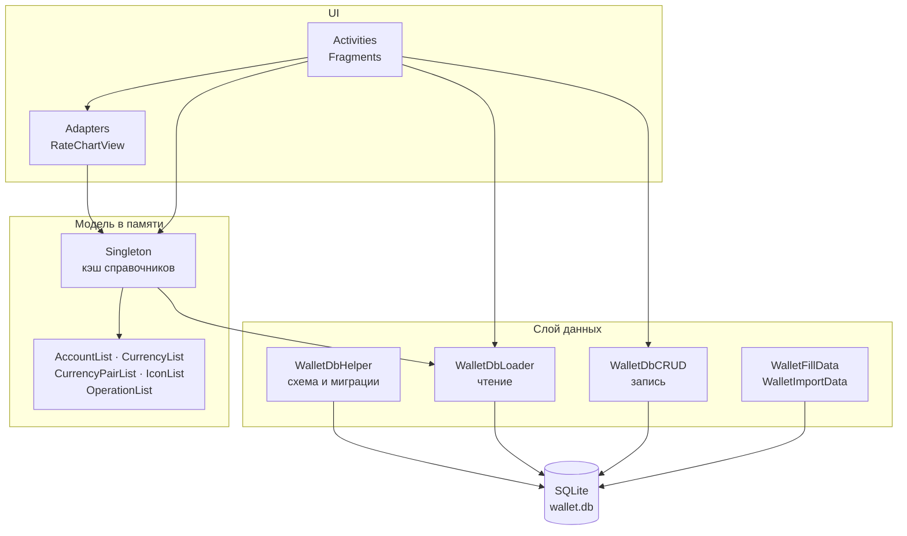
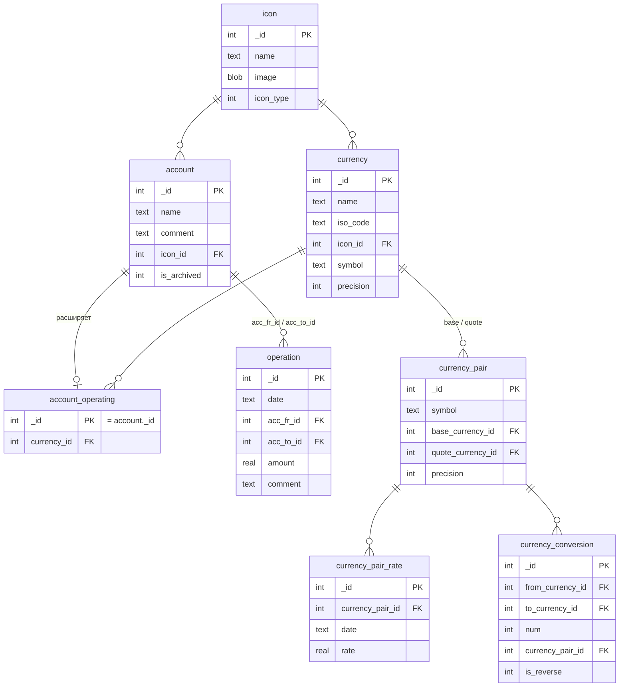
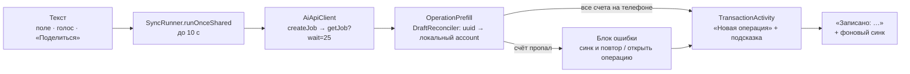
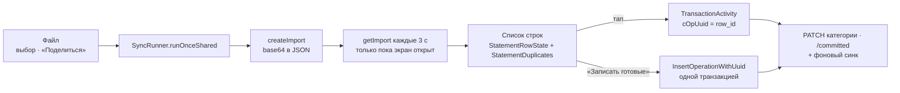

# Устройство приложения

Классический слоёный Android-проект без DI и без Room: экраны обращаются к
процессному кэшу-синглтону, а весь SQL сосредоточен в четырёх классах слоя данных.

## Слои



**UI** — `Activities/` и `Adapters/`. Наследуются от `AppCompatActivity`, тема
`AppTheme.NoActionBar` там, где нужен свой `Toolbar`. Единственное кастомное
представление — `Views/RateChartView` (график курса с перетаскиваемым выделением периода).

**Модель в памяти** — коллекции из `DataItems/`. Списки уведомляют подписчиков через
самодельный `onListChanged` (`List<ListChanged>`), без LiveData.

**Слой данных** — `Data/`:

| Класс | Ответственность |
| --- | --- |
| `WalletContract` | Имена таблиц и колонок, единый источник строковых литералов |
| `WalletDbHelper` | `onCreate` / `onUpgrade`, создание таблиц и представлений |
| `WalletDbLoader` | Все запросы на чтение, включая отчётные |
| `WalletDbCRUD` | Вставки, обновления, удаления, чистка битых операций |
| `WalletFillData` | Первичное наполнение справочников |
| `WalletImportData` | Импорт CSV |

## Кэш справочников

`Singleton.instance` — статический объект процесса. Держит долгоживущие
`SQLiteDatabase` (readable и writable) и лениво загружаемые справочники.

```java
Singleton.instance.getIconList(context);        // грузит один раз
Singleton.instance.reloadIconList(context);     // сбрасывает и перечитывает
```

Кэш надо инвалидировать вручную после записи в базу. `IconEditDialog` вызывает
`reloadIconList` после вставки, обновления и удаления, а `IconManagerActivity`
затем пересобирает адаптер целиком — при смене `icon_type` иконка переезжает
в другую группу, и `notifyDataSetChanged` этого не отразит.

`getCurrencyPairList` ведёт себя иначе: перечитывает базу при **каждом** вызове.
Поэтому `CurrencyPairList.clear()` обязателен внутри загрузчика, иначе список
дублируется. Расхождение с остальными геттерами намеренным не выглядит.

## Общая шапка корневых экранов

Четыре таба нижней панели — «Операции» (`MainActivity`), «Кошельки»
(`AccountActivity`), «Отчёты» (`ReportActivity`), «Ещё» (`MoreActivity`) —
наследуются от `BaseTabActivity`. Экран сам знает только про свой список; всё
остальное в шапке общее и живёт в одном месте.

```
setContentView(...) → свои findViewById → initTabScreen(tabId, title) → reloadSharedAndTabData()
                                                                              │
                                        refreshSummaryCard() + refreshFilterBanner() + reloadTabData()
```

| Что | Где |
| --- | --- |
| Период, фильтр по счетам, валюта эквивалента | `PeriodFilterState` (один объект на процесс) |
| Заголовок, кнопки фильтра и валюты | `view_tab_title.xml` + `view_tab_actions.xml` (оба `<merge>`) |
| Пилюля периода, карточка состояния денег, строка фильтра | `view_period_summary.xml` |
| Нижняя панель и «+» | `view_bottom_nav.xml` + `BottomNav.setActiveTab` |
| Цифры карточки | `BaseTabActivity.refreshSummaryCard()` — одна реализация на все табы |

`PeriodFilterState` дублирует своё состояние в `AppSettings`
(SharedPreferences), поэтому период и фильтр переживают и переход между табами,
и перезапуск приложения. Переходы по панели идут с
`FLAG_ACTIVITY_REORDER_TO_FRONT`: уже открытый таб поднимается, а не создаётся
заново. Чтобы поднятый экран не показывал устаревшее, состояние считает правки
счётчиком `revision`, а `onResume` сравнивает его с тем, что экран отрисовал.

Экраны «вглубь» (операция, фильтр, пикеры, настройки, курсы) панель и шапку не
подключают и наследуются напрямую от `AppCompatActivity`. `AccountActivity` в
режиме пикера (`cAccountSelectedType`) вообще не ставит layout — `initTabScreen`
там не вызывается, и `BaseTabActivity` это учитывает.

Фильтр по счетам доходит только до ленты операций: `LoadOperations` принимает
`DataFilter`, а `GenerateReportGetBalanceToDate` его аргумент игнорирует, и
отчётные запросы дохода/расхода его не принимают вовсе. То есть при активном
фильтре список сужается, а цифры карточки остаются за весь период — так было и
до вынесения шапки в общий блок, но теперь это правится в одном месте.

## Схема базы



### Кошельки и категории — одна таблица

`account` хранит и кошельки, и статьи расходов. Кошелёк отличается наличием строки
в `account_operating` с тем же `_id` — там лежит валюта. Это наследование через
общий первичный ключ, а не отдельные таблицы.

Отсюда `AccountItem.isOperatingAccount()` и представления `v_account_operating`
(все счёта с валютой, у категорий она `NULL`) и `v_account_expanse`
(только те, у кого нет строки в `account_operating`).

Транзакция — всегда перевод между двумя `account`: расход это «кошелёк → категория»,
доход «категория → кошелёк», перевод «кошелёк → кошелёк». Операция
«категория → категория» бессмысленна и отсекается в трёх местах: валидацией в
`TransactionActivity`, пропуском при загрузке в `WalletDbLoader` и защитой от `null`
в `TransactionArrayAdapter`.

### Представления

| Представление | Что делает |
| --- | --- |
| `v_account_operating` | Счёта с валютой (`LEFT JOIN account_operating`) |
| `v_account_expanse` | Счёта без валюты, то есть категории |
| `v_currency_conversion` | Раскрывает каждую пару в **два** направления: прямое и обратное с флагом `is_reverse` |
| `v_currency_conversion_rate` | Курс на дату с уже применённым `1.0/rate` для обратного направления; через `UNION` добавляет тождественный курс 1 валюты к себе с датой `2000-01-01` |
| `v_operation` | Операция с именами счётов и валютой |
| `v_operation_eq` | Операция с курсом на свою дату и суммой в эквиваленте |

Два приёма стоит держать в голове.

Во-первых, `v_currency_conversion` избавляет запросы от необходимости знать, в какую
сторону задана пара: достаточно спросить курс `from → to`, обратный посчитается сам.

Во-вторых, `UNION` с тождественным курсом в `v_currency_conversion_rate` означает,
что пересчёт валюты в саму себя всегда находит курс 1 — отдельная ветка «если валюты
совпадают» в вызывающем коде не нужна.

### Курс на дату

Везде, где нужен курс, применяется один шаблон: сначала `max(date)` не позже нужной
даты, затем join обратно к представлению по этой дате.

```sql
LEFT JOIN (SELECT from_currency_id, to_currency_id, max(date) max_date
           FROM v_currency_conversion_rate WHERE date <= ?
           GROUP BY from_currency_id, to_currency_id) mx
       ON mx.from_currency_id = c._id AND mx.to_currency_id = ?
LEFT JOIN v_currency_conversion_rate vccr
       ON vccr.from_currency_id = mx.from_currency_id
      AND vccr.to_currency_id   = mx.to_currency_id
      AND vccr.date             = mx.max_date
```

## Расчёт балансов

Баланс кошелька — разница поступлений и списаний до даты:

```sql
round(coalesce(opt.amount_to, 0) - coalesce(opf.amount_fr, 0), c.precision)
```

где `opt` — сумма операций с `acc_to_id = кошелёк`, `opf` — с `acc_fr_id = кошелёк`,
обе с условием `date < ?`.

Единственная реализация живёт в `WalletDbLoader.LoadBalancesPerWallet` и логирует
свой SQL и параметры в logcat под тегом `WalletDbLoader`. Она обслуживает оба места:

- `BalanceReportActivity` — построчный список кошельков
- `GenerateReportGetBalanceToDate` — суммирует её результат для полей
  «баланс на начало / на конец» в `ReportActivity`

Раньше у отчёта за период был свой SQL (`getBalancesToDate`), и цифры расходились.
Теперь источник один. Константа `getBalancesToDate` всё ещё используется другими
отчётными методами того же класса.

### Три состояния эквивалента

`WalletBalanceRow` различает не два случая, а три, и от этого зависят и отображение,
и итоги:

| `hasEq` | `approx` | Значит | Показ |
| --- | --- | --- | --- |
| `true` | `false` | Кошелёк уже в валюте эквивалента | число без пометки |
| `true` | `true` | Пересчёт по курсу | `≈ ` + число |
| `false` | — | Курса к валюте эквивалента нет | `~` без числа |

Два знака различаются по смыслу и не взаимозаменяемы: `≈` значит «число посчитано,
но через курс», `~` — «числа нет». Поэтому в агрегатах `~` перекрывает `≈`: сумма,
из которой выпал кошелёк, занижена на неизвестную величину, и это более сильное
предупреждение, чем округление. Логика собрана в `BalanceReportActivity.totalMarker`
и в `AdapterUtils`:

```java
String aproxSign = isIncomplete ? "~" : isAprox ? "≈" : "";
```

`EquivalentResult` несёт оба признака: `approxEq` (был пересчёт) и `incomplete`
(что-то не удалось пересчитать и было исключено из суммы). Перегрузки
`AdapterUtils.setAmountText`, принимающие `EquivalentResult`, передают оба —
вызовы, передающие только `boolean isAprox`, трактуются как «пересчёт», то есть `≈`.

Ключевое место — **отсутствие `coalesce` на курсе** в SELECT:

```sql
round(vccr.rate * (coalesce(opt.amount_to, 0) - coalesce(opf.amount_fr, 0)), 2) balance_eq
```

Если поставить сюда `coalesce(vccr.rate, 1)`, то `balance_eq` перестанет быть `NULL`,
`hasEq` всегда окажется `true`, а кошельки без курса молча войдут в итоги по курсу 1:1
и завысят их. Так и было до правки.

`ORDER BY balance_eq DESC` при этом оставляет строки без эквивалента в конце списка:
в SQLite `NULL` меньше любого значения.

Итоги считаются по всем строкам с `hasEq`, а строки без него исключаются и помечают
сумму как приблизительную — исключение кошелька занижает итог, поэтому пометка нужна
в обоих случаях.

Тот же принцип в списке счётов: `AccountOperatingItem.getBalanceEq` возвращает
`Double` и `null` при отсутствии курса. Раньше он отдавал `-1` как признак
«посчитать нельзя», из-за чего кошелёк с отрицательным балансом (кредитка, овердрафт)
показывался как `~` вместо своего эквивалента.

## Точность

Точность — не константа, а поле:

- `currency.precision` — знаков в суммах этой валюты (миграция ставит 2)
- `currency_pair.precision` — знаков в курсе пары (миграция ставит 5)

Форматирование идёт через `AdapterUtils.getFormat(precision)` с кэшем
`DecimalFormat` по числу знаков. Класс — **`android.icu.text.DecimalFormat`**,
а не `java.text.DecimalFormat`; при работе с результатом нужен тот же импорт,
иначе компилятор не приведёт типы.

Тот же `precision` ограничивает ввод в полях суммы через `InputFilter`.

## Миграции

`DATABASE_VERSION = 72` в `WalletDbHelper`.

`onUpgrade` разветвляется по порогу 68. Для 68 и выше — инкрементальные `ALTER TABLE`
(69 добавила `currency.precision`, 70 — `currency_pair.precision`, 71 — таблицу
`operation_link`, 72 — четыре колонки синка на все 9 синхронизируемых таблиц плюс
первые настоящие триггеры схемы, см. [`schema/README.md`](../schema/README.md), раздел «v72 —
синхронизация с сервером», и `org/docs/TODO_mobile_sync.md`, Фаза 3). Для более
старых баз — полное пересоздание: `DROP` всех представлений и таблиц в порядке
зависимостей, затем `onCreate`. Данные при этом теряются.

Новая миграция — это новый блок `if (oldVersion < N)` **и** правка соответствующего
`CREATE TABLE`, иначе чистая установка и обновление разойдутся. С v72 это верно и
для представлений: раньше `CreateViews` вызывалась только из `onCreate`/полного
пересоздания, теперь шаг `oldVersion < 72` зовёт её и поверх уже существующей базы
(сама она безопасна для повторного вызова — начинает каждый блок с `DROP VIEW IF
EXISTS`).

`getWritableDatabase` переопределён и включает `PRAGMA foreign_keys = ON` — на
readable-соединении внешние ключи не проверяются.

### Один uuid — одна операция (v83)

С v83 у `operation` уникальный индекс `ux_operation_uuid` по
`lower(replace(uuid, '-', ''))` — тем же правилам, по которым uuid ищет pull
(`SyncEngine.localUuid`: с дефисами и без, любой регистр). На сервере
`operation` — `PRIMARY KEY (ledger_id, uuid)`: две локальные строки с одним uuid
после синка расходятся с ним (на телефоне две траты, на сервере одна). Повод —
импорт выписки, который пишет операции с заранее известным uuid (`row_id` строки,
change `add-ai-statement-import`).

Шаг `oldVersion < 83` сначала сводит дубли (`WalletDbHelper.dedupeOperationUuids`):
на uuid остаётся одна строка — живая, с меньшим `_id`; лишние помечаются
удалёнными **и получают новый uuid**. Со старым их tombstone при синке удалил бы
на сервере ту операцию, которую представляет оставшаяся строка.

Вставка с заданным uuid — `WalletDbCRUD.InsertOperationWithUuid`: живая с этим
uuid уже есть — `UUID_TAKEN`, вторая не создаётся; удалённая есть — та же строка
получает новые поля и `deleted_at = NULL`. Обычный `InsertOperation` по-прежнему
ставит случайный uuid.

## Иконки

Хранятся в базе как BLOB, не в ресурсах: пользователь добавляет свои из галереи.

Путь добавления: галерея → системный кроп 1:1 → `resizeBitmap` до 256×256 →
`compress(WEBP, 85)` → `INSERT`.

Две вещи здесь неочевидны.

`ICON_SIZE_PX = 256` выбран по фактическому потреблению: самая крупная отрисовка —
`Icon.getBitmap64()` (164 px) и ячейка сетки 48 dp (192 px на xxxhdpi). Прежние 512
были избыточны.

Результат кропа забирается **через временный файл** в `getCacheDir()`, а не через
`return-data`: битмап 512×512 ARGB весит около 1 МБ и не проходит лимит
Binder-транзакции (~500 КБ), из-за чего extras приходили пустыми. Файл отдаётся
кроп-приложению как `FileProvider`-Uri, поэтому в `file_provider_paths.xml` есть
`cache-path`. Если кроп-приложения нет, пользователь отменил кроп или файл нечитаем —
срабатывает кадрирование по центру.

`icon.icon_type` группирует иконки на экране: `0` — категория, `1` — флаг.
Порядок значений в `Icon.IconType` подогнан под уже лежащие в базе данные.
`IconType.fromValue` возвращает `CATEGORY` для всего, кроме `1`.

## Загрузка курсов

`CurrencyPairRateListActivity` выбирает источник по составу пары:

- есть `RUB` → ЦБ РФ, `XML_dynamic.asp`, XML в **Windows-1251**, код валюты
  берётся из таблицы `CBR_CODES` внутри активности
- иначе → Frankfurter, JSON

Шаг выборки задаётся в диалоге: каждый день, понедельник каждой недели или
1-е число месяца. Записи вставляются пачкой через `insert or replace`,
так что повторная загрузка того же периода безопасна.

Развязка по двум источникам планируется к замене на один универсальный провайдер,
так что таблица `CBR_CODES` и разбор Windows-1251 — временная конструкция.

## Синхронизация

Пакет `sync/`: `SyncEngine` (push dirty-строк и pull чужих изменений,
протокол — README wallet-api), транспорт `SyncApiClient`, токены `AuthSession`.
Проход целиком (refresh → push → pull) — `SyncRunner`.

Проход идёт **один на процесс**. Его зовут три места: `SyncWorker` по
расписанию, кнопка «Синхронизировать сейчас» (`IntegrationsActivity`) и экран
«ИИ» перед разбором траты. `SyncRunner` держит текущий проход как `FutureTask`
на своём потоке; если он уже идёт, новый вызов не запускает второй, а ждёт исход
идущего. Раньше кнопка и воркер могли идти параллельно: одни и те же строки
уезжали двумя порциями, два pull двигали курсоры в `AppSettings`.

- `runOnce(ctx)` — ждёт исход до конца (воркер, кнопка).
- `runOnceShared(ctx, timeoutMs)` — ждёт не дольше таймаута и тогда отвечает
  `Status.STILL_RUNNING`; проход не прерывается и доходит до конца в фоне.

Время последнего прохода с исходом `OK`/`PARTIAL` — `AppSettings.getLastSyncSuccessAt`.

`AuthSession.ensureFresh` — `synchronized`: refresh-токен одноразовый, и два
параллельных refresh (проход синка и запрос экрана «ИИ») отдали бы один и тот же
токен — второй получил бы 401 и ложное «Нужна повторная авторизация». Запросы вне
синка зовут `ensureFreshForRequest`: refresh только если access-токен истекает
меньше чем через минуту.

## Экран «ИИ»

Трата своими словами через wallet-ai (`/api/ai/*`, контракт — `wallet-ai/openapi.yaml`).
Поведение — spec `openspec/specs/ai-expense-entry` (change `add-ai-client`,
правка в окне операции — `ai-expense-in-operation-window`).



| Класс | Ответственность |
| --- | --- |
| `Activities/AiActivity` | Экран: ввод, ожидание, блок ошибки «пропал», результат окна операции. Приём `ACTION_SEND` `text/plain` |
| `sync/AiApiClient` | Транспорт: status, jobs; свой `readTimeout` дольше long-poll |
| `ai/ParseExpenseResult` | Разбор `ParseExpenseResult` из ответа задания |
| `ai/DraftReconciler` | Сверка uuid черновика с телефоном: есть / нет / удалён / в архиве |
| `ai/OperationPrefill` | Поля окна операции из черновика: живые счета, кандидаты для пикеров, подсказка |
| `ai/AiTexts` | Тексты ошибок и деталей — дословно из спеки, под юнит-тестом |

Почему синк перед разбором: resolver wallet-ai выбирает кошелёк и категорию по
справочнику **сервера** (wallet-report), а записывать можно только на строку,
которая есть в локальной базе. Push отдаёт серверу то, что создано на телефоне,
pull приносит созданное в вебе и боте. Если uuid из черновика локально всё равно
не нашёлся, окно не открывается сразу: экран «ИИ» показывает блок ошибки.

Правка и запись — в обычном окне операции, отдельной карточки нет. Окно
принимает от экрана «ИИ»:

| Extra `TransactionActivity` | Что |
| --- | --- |
| `cHint` | строка «Подсказка ИИ: …» над полями (исходный текст, вопросы resolver, `notes`) |
| `cPriorityWalletIds`, `cPriorityCategoryIds` | `int[]` `_id` кандидатов resolver; окно передаёт их пикеру как `AccountPickerActivity.cPriorityIds` — первыми при любой сортировке |
| `cOpUuid` | uuid новой операции (экран «Выписка»: `row_id` строки). Живая операция с ним есть — окно открывается как «Изменение операции» этой операции; удалённая — «Сохранить» восстанавливает ту же строку. У перевода uuid получает главная проводка, вторая нога и комиссия — свои |
| результат `cSavedOperationId` | `_id` главной проводки после «Сохранить»; у удаления его нет |

По `cSavedOperationId` экран «ИИ» строит «Записано: …» из сохранённой операции
(пользователь мог сменить сумму, счета, вид). Закрыли окно без сохранения —
черновик остаётся («Открыть снова» без нового запроса к ИИ), он же переживает
пересоздание экрана через `onSaveInstanceState`.

`default_wallet_uuid` — `AppSettings.getAiLastWalletUuid`, серверное написание
uuid (с дефисами): локально встречаются uuid без дефисов (`LocalUuid.find`).

Сеть — на голом `new Thread`; поздний ответ отменённого разбора отсекает счётчик
`generation`. В logcat — только id задания, статусы и длительности.

## Экран «Выписка»

Импорт банковской выписки через wallet-ai (`/api/ai/imports*`, контракт —
`wallet-ai/openapi.yaml`). Поведение — change `add-ai-statement-import`, спеки
`ai-statement-import` и `operation-identity`. Задача ИИ — разобрать выписку и
предложить категории; дубли ищет телефон по своим операциям, серверные группы
дублей (`exists`, `imported`, `possible_duplicate`) не используются.



| Класс | Ответственность |
| --- | --- |
| `Activities/StatementImportActivity` | Экран: файл и кошелёк, загрузка, ожидание, список, запись по одной и пачкой. Приём `ACTION_SEND` с `EXTRA_STREAM` (PDF, CSV, текст); текст без файла уходит на экран «ИИ» |
| `sync/AiApiClient` | `createImport`, `listImports`, `getImport`, `patchImportRowCategory`, `commitImportRows`; `HttpError.importId` у 429 `import_in_progress` |
| `ai/StatementImport` | Импорт и строки из ответа; незнакомые статусы, группы и поля не ломают разбор |
| `ai/StatementDuplicates` | Дубль по полям: тот же кошелёк, та же сумма, дата ±1 день, не из этого импорта; один к одному, ближайший по дате |
| `ai/StatementRowState` | Состояние строки по порядку: «Добавлена», «Не для записи», «Проверить», «Похоже, уже есть», «Нужна категория», «Ждёт»; отбор «готовых» |
| `ai/AiTexts` | Тексты экрана — дословно из спеки, под юнит-тестом |

**Строка и операция связаны через `row_id`.** Операция из строки сохраняется с
`uuid = row_id`. Отдельного флага «добавлено» нет: строка добавлена, если на
телефоне есть живая операция с этим uuid (`WalletDbCRUD.FindOperationByUuid`).
Удалили операцию — строка снова «Ждёт». `row_id` не зависит от промпта, суммы и
даты, а `op_uuid` сервера — зависит, поэтому клиент на него не опирается.
Повторную загрузку той же выписки (новые `row_id`) ловит проверка дублей по
полям.

**Строки на телефоне не хранятся.** Список каждый раз берётся с сервера
(`GET /api/ai/imports/{id}`), перед первым показом за открытие экрана — синк,
чтобы проверка дублей видела операции из веба и бота. Незавершённый (или
готовый, но не записанный) импорт после перезапуска находится через
`GET /api/ai/imports`. Без сети список не открывается; уже открытый остаётся
рабочим — запись идёт в базу телефона.

**Отметка на сервере.** После записи строки: категория, если она отличается от
серверной, — `PATCH rows` (только `category_uuid`: сервер выучит правило
продавца и проставит категорию похожим строкам), затем `POST /committed` и
фоновый `SyncRunner.runOnce`. Сумма и дата на сервер не уходят. Не прошла
отметка (нет сети) — строка «Добавлена» с `committed: false` дошлётся в
`/committed` при следующем открытии списка.

Записываются только расходы «кошелёк выписки → категория», дата — день строки
в 12:00, комментарий — описание (продавец). Доходы, переводы и незнакомые группы
сервера — «не для записи».

## Известные шероховатости

Это не задачи, а места, где поведение расходится с ожидаемым по имени.

- `AccountList.getIncomeAccounts()` возвращает **все** счёта без фильтрации. В схеме
  нет разделения на доходные и расходные категории — только операционные и нет.
  Вкладка «доходы» показывает всё.
- `Singleton` держит `SQLiteDatabase` на весь процесс, при этом часть экранов
  открывает свои соединения через `new WalletDbHelper(...)` и закрывает их в `finally`.
  Две модели работы с соединением сосуществуют.
- `MainActivity.transactions` — `public static OperationList`. Список операций живёт
  вне `Singleton` и вне жизненного цикла активности.
- Проект на Support Library 28. Пакеты `android.support.*`, миграция на AndroidX
  не выполнялась; `android.arch.lifecycle` тоже доandroidx-овский.
- `package` объявлен в `AndroidManifest.xml`, а не через `namespace` в Gradle —
  AGP предупреждает о deprecation.
- Строки интерфейса частью в `strings.xml`, частью захардкожены в активностях.
